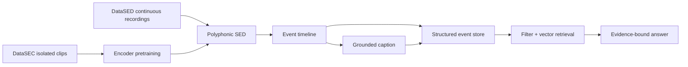

# Grounded Environmental Audio Monitoring and RAG-based Event Retrieval

Khóa luận Khoa học dữ liệu (IUH K18): **"Xây dựng hệ thống phát hiện, sinh mô tả và truy vấn sự kiện
âm thanh môi trường dựa trên RAG"**.

> **Trạng thái (24/11/2026):** hệ thống hoàn chỉnh, mọi số đã khóa và báo cáo chính thức đã dựng
> ([PDF](report/Khoa_luan_environmental_audio_rag.pdf)). Chỉ còn field test bằng clip điện thoại và
> đọc lại trước hạn nộp 28/11. Không train lại, không mở thêm test. Tiến độ chi tiết:
> [CLAUDE.md §3](CLAUDE.md).

## 0. Người mới: đọc theo thứ tự này

Mục tiêu là trong khoảng nửa ngày nắm được hệ thống làm gì, vì sao làm vậy, và số nào nói lên điều gì.

| Bước | Đọc | Để hiểu |
|---|---|---|
| 1 | README này (mục 1–3) | Bài toán, kết quả chính, hệ thống cuối |
| 2 | [Báo cáo khóa luận (PDF)](report/Khoa_luan_environmental_audio_rag.pdf): tóm tắt, Chương 1, Chương 7 | Câu hỏi nghiên cứu và kết luận, đọc trước để biết đích |
| 3 | Báo cáo Chương 3–5 | Dữ liệu, phương pháp, triển khai |
| 4 | Báo cáo Chương 6 | Kết quả RQ1–RQ3 và cách đọc từng bảng |
| 5 | [docs/evaluation_protocol.md](docs/evaluation_protocol.md) | Số nào có nghĩa, số nào **không** được diễn giải |
| 6 | [docs/DEMO.md](docs/DEMO.md), rồi chạy demo (mục 9) | Thấy hệ thống chạy thật: tải lên, dòng thời gian, mô tả, truy vấn |
| 7 | [docs/SYSTEM.md](docs/SYSTEM.md) | Đặc tả kỹ thuật đầy đủ khi cần chi tiết |
| 8 | [docs/decisions/](docs/decisions/) (ADR) | Vì sao chọn mỗi quyết định; ADR mới nhất là 0041–0050 |
| 9 | [docs/PAPER_NOTES.md](docs/PAPER_NOTES.md) | Mọi thí nghiệm, kể cả kết quả âm tính, kèm file bằng chứng |
| 10 | [report/slide/kich_ban_bao_ve.md](report/slide/kich_ban_bao_ve.md), [report/slide_bao_ve.pptx](report/slide_bao_ve.pptx) | Kịch bản bảo vệ (bản 11/11, chưa có backfill và mô tả gộp) |

Câu hỏi hội đồng hay hỏi và chỗ trả lời: hybrid có hơn vector không (Chương 6, mục backfill, ADR-0049);
"0 ảo giác" có phải do cấu tạo không (Chương 6, mục mô tả so với nhãn gốc); vì sao RQ1 âm tính
(ADR-0021); vì sao SED event-F1 thấp (Chương 6, phân rã lỗi; ADR-0045).

## 1. Bài toán

Hệ thống nhận recording môi trường dài, phát hiện lớp sự kiện cùng onset/offset, sinh mô tả chỉ từ
dòng thời gian sự kiện, lưu sự kiện có cấu trúc và trả lời truy vấn dựa trên bằng chứng đã lưu.

```text
audio → SED (B0 + LBR) → event timeline → mô tả có căn cứ → event store (PostgreSQL + pgvector) → truy hồi + câu trả lời có trích dẫn
```

Phạm vi dữ liệu:

- **DataSEC:** clip sự kiện tách rời; dùng cho pretraining, classification và subclass refinement.
- **DataSED:** recording thực tế liên tục; dùng cho temporal/polyphonic SED và benchmark chính (21 lớp).

Hệ thống không tuyên bố phát hiện tội phạm, ý định, tình trạng khẩn cấp hay mức nguy hiểm. Output chỉ
mô tả nguồn âm quan sát được ([ADR-0001](docs/decisions/ADR-0001-scope-and-datasets.md)).

## 2. Câu hỏi nghiên cứu và kết quả

| RQ | Câu hỏi | Kết quả (chi tiết ở Chương 6) |
|---|---|---|
| RQ1 | Pretraining thêm trên DataSEC có cải thiện SED trên DataSED? | **Âm tính:** pretraining AudioSet giúp rõ, thêm DataSEC không tạo khác biệt đo được ([ADR-0021](docs/decisions/ADR-0021-rq1-ket-qua-am-tinh.md)) |
| RQ2 | Mô tả ràng buộc vào dòng thời gian có giảm ảo giác so với sinh tự do? | Ràng buộc đưa suy diễn bối cảnh, gọi tên quá mức và từ cấm về 0; so với **nhãn gốc** thì lỗi còn lại đến từ SED, không từ bộ sinh |
| RQ3 | Lọc cấu trúc + truy hồi vector có tốt hơn từng cách riêng? | Hybrid thuần thua vector_only khi SED bỏ sót; chế độ **backfill** (ADR-0049) thắng cả hai ở bốn kho trên test |

SED: hệ thống cuối là **B0** (frame_mn, ensemble 5 fold, suy luận chồng lấn) cộng **LBR** (tinh chỉnh
biên và chấm lại box học trên OOF). Trên test có nhãn (139 recording), event-F1 micro B0 0.1806 →
LBR V2 0.2965. Demo phục vụ LBR V3 (điểm ưu tiên phát hiện), là cấu hình ứng dụng chứ không phải số
chính ([ADR-0045](docs/decisions/ADR-0045-lbr-tinh-chinh-bien-va-cham-lai-box.md),
[ADR-0047](docs/decisions/ADR-0047-rq2-rq3-tren-event-lbr.md)).

Demo: truy hồi mặc định ở chế độ backfill (kết quả thỏa bộ lọc là bằng chứng; kết quả gần nghĩa chỉ
được nêu tên). Mô tả gộp theo lớp, kiểu thông báo, có nhãn "độ tin cậy thấp" theo điểm SED
([ADR-0050](docs/decisions/ADR-0050-template-gop-theo-lop-va-rao-don.md)).

## 3. Đóng góp

- **C1** Bộ sinh mô tả có căn cứ, với hợp đồng kiểm được bằng máy (G1–G3).
- **C2** Bộ chỉ số đo mức bám sát sự kiện của mô tả âm thanh, kèm phép thử độ nhạy của chính bộ chấm.
- **C3** Đo chuyển giao clip rời → recording liên tục, có kiểm soát trùng lặp xuyên dataset.
- **C4** RAG trên dòng thời gian sự kiện có điều kiện thời gian (trước/sau, thời lượng).
- **LBR** Tinh chỉnh biên học được, nâng event-F1 test mà không train lại SED.

## 4. Kiến trúc



Chi tiết: [SYSTEM](docs/SYSTEM.md), [DATA_PLAN](docs/DATA_PLAN.md), [taxonomy](docs/taxonomy.md), [evaluation protocol](docs/evaluation_protocol.md).

## 5. Cấu trúc repository

```text
environmental-audio-rag/
├── contracts/          # schema giao tiếp giữa data, model và service
├── data/               # raw/interim/features/annotations/manifests/splits
├── docs/               # đặc tả, kế hoạch, protocol, ADR, measurements
├── ml/                 # datasets, features, models, training, evaluation
├── notebooks/          # chỉ dùng khám phá; logic chính phải vào ml/ hoặc scripts/
├── scripts/            # entry point tái lập pipeline
├── services/           # api, inference, frontend, stream
└── tests/              # contract, unit và integration tests
```

## 6. Nguồn chân lý

| Nội dung | File | Khi nào đọc |
|---|---|---|
| **Đang ở đâu, làm gì tiếp** | [CLAUDE.md](CLAUDE.md) | **Đầu mỗi phiên** |
| Đặc tả hệ thống (khung báo cáo) | [docs/SYSTEM.md](docs/SYSTEM.md) | Khi cần chi tiết kỹ thuật |
| Trạng thái có bằng chứng | [docs/STATUS.md](docs/STATUS.md) | Khi cần số liệu hiện hành |
| Roadmap 8 tuần | [docs/PLAN.md](docs/PLAN.md) | Đầu mỗi tuần |
| Dữ liệu, dedup và split | [docs/DATA_PLAN.md](docs/DATA_PLAN.md) | Suốt giai đoạn D1–D4 |
| 22 lớp và ranh giới | [docs/taxonomy.md](docs/taxonomy.md) | Khi làm việc với nhãn hoặc caption |
| Xử lý nhãn | [docs/annotation_guideline.md](docs/annotation_guideline.md) | Khi viết parser nhãn |
| **Số nào có nghĩa, số đó KHÔNG nói gì** | [docs/evaluation_protocol.md](docs/evaluation_protocol.md) | **Trước khi báo cáo bất kỳ con số nào** |
| Vận hành huấn luyện | [docs/TRAINING_OPS_PLAN.md](docs/TRAINING_OPS_PLAN.md) | Trước lần train mới |
| Văn liệu và mức xác minh | [docs/RELATED_WORK.md](docs/RELATED_WORK.md) | Khi viết Chương 2 |
| Inventory (sinh tự động) | [docs/data_inventory.md](docs/data_inventory.md) | Khi cần số liệu dữ liệu |
| Quyết định kiến trúc | [docs/decisions/](docs/decisions/) | Khi định thay đổi kiến trúc |
| Số đo (sinh tự động) | [docs/measurements/](docs/measurements/) | Khi cần bằng chứng cho một claim |

## 7. Nguyên tắc

- Không commit raw audio, feature tensor, checkpoint hoặc vector index.
- Không sửa nhãn nguồn để làm đẹp kết quả; mọi exclusion cần reason code.
- Không dùng DataSED test để chọn threshold, duration prior hoặc checkpoint.
- Caption không được thêm event ngoài timeline đầu vào.
- Mọi số liệu trong báo cáo phải truy ngược được tới manifest, config và model artifact.

## 8. Dữ liệu và license

Hai dataset dùng trong đề tài, cả hai **CC-BY-NC-SA-4.0**:

| Dataset | Record DOI | Files |
|---|---|---:|
| DataSEC | [10.5281/zenodo.17033970](https://doi.org/10.5281/zenodo.17033970) | 5,048 |
| DataSED | [10.5281/zenodo.15346092](https://doi.org/10.5281/zenodo.15346092) | 717 |

Tác giả: Fredianelli L., Artuso F., Pompei G., Licitra G., Iannace G., Akbaba A.

**Ràng buộc `SA` áp lên derivative:** feature, checkpoint và caption sinh từ dữ
liệu này nếu công bố phải cùng CC-BY-NC-SA-4.0, **không** được MIT/Apache. Code
pipeline là tác phẩm độc lập nên có thể license riêng. Chi tiết:
[DATA_PLAN §3](docs/DATA_PLAN.md). Nhãn và metadata dẫn xuất có trong repo:
[data/NOTICE.md](data/NOTICE.md).

Không archive nào chứa LICENSE hay README — license chỉ lấy được từ Zenodo record
metadata đã lưu trong `data/reference/`.

## 9. Bắt đầu

```bash
python -m venv .venv
.venv/Scripts/python.exe -m pip install -r requirements.txt
.venv/Scripts/python.exe -m pip install -r requirements-torch.txt     --index-url https://download.pytorch.org/whl/cu128
.venv/Scripts/python.exe -m pip install -r requirements-eval.txt      # sed_eval, psds_eval
.venv/Scripts/python.exe -m pip install -r requirements-db.txt        # tùy chọn: event store
.venv/Scripts/python.exe -m pip install -r requirements-retrieval.txt # BGE-M3 (W6, inference)
.venv/Scripts/python.exe -m pip install -r requirements-services.txt  # FastAPI (W7)

.venv/Scripts/python.exe -m pytest -q
.venv/Scripts/python.exe -m ruff check .
```

Lệnh tái lập pipeline: [CLAUDE.md §7](CLAUDE.md).

### Chạy demo ([docs/DEMO.md](docs/DEMO.md))

Cần Docker Desktop (PostgreSQL + pgvector), các run B0/LBR trong `ml/runs/`, BGE-M3 trong
`artifacts/hf/` (không có trong git; xin bản sao từ máy của nhóm).

```powershell
.\scripts\demo_up.ps1      # build và bật db, inference, api + giao diện; mở http://127.0.0.1:8088
.\scripts\demo_check.ps1   # kiểm nhanh các dịch vụ
.\scripts\demo_down.ps1    # tắt khi xong
```

Phát triển giao diện: `cd services/frontend && npm ci && npm run dev` (proxy `/api` tới
`VITE_API_TARGET`, mặc định `http://localhost:8010`).
