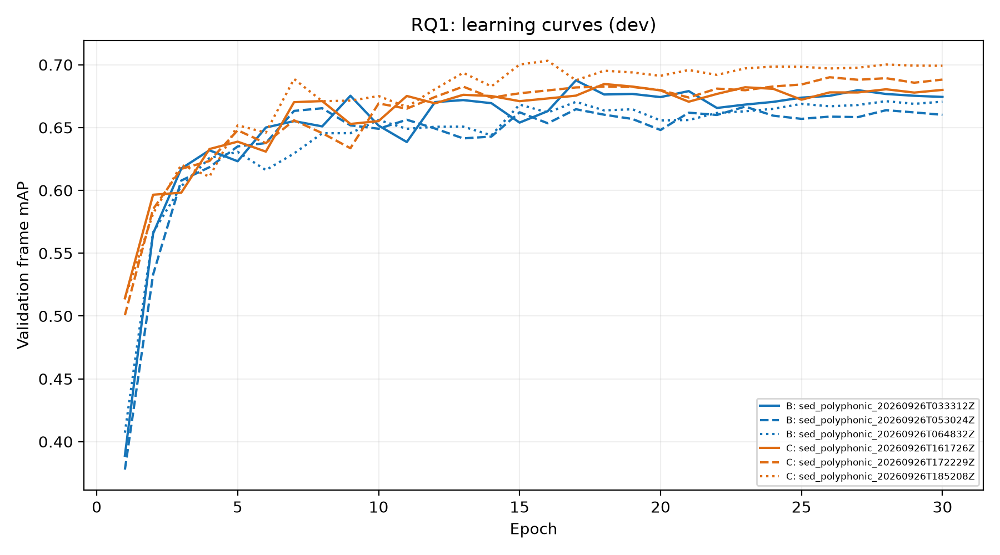

# Cơ chế RQ1: nhận dạng và định vị

Sinh bởi `scripts.report_rq1_mechanism`; chỉ history + prediction dev.

**Dev annotated, in-sample:** hậu xử lý được chọn trên dev. Chỉ dùng so B với C; không dùng chọn hệ thống hoặc tuyên bố suy rộng. Event/segment-F1 là micro; frame mAP là macro trên lớp có positive. Frame AP lấy window frames hợp lệ trong mask, còn F1 dùng xác suất ghép theo recording, bỏ recording thiếu GT.

Collar chuẩn: onset 0.2 s, offset max(0.2 s, 20% độ dài). Collar 1 s: onset 1 s, offset max(1 s, 50% độ dài). Chỉ onset/offset giữ collar chuẩn.

## Phân rã dev

| Metric | B mean | C mean | C − B | C>B / tổng cặp |
|---|---:|---:|---:|---:|
| frame_map | 0.685940 | 0.705157 | +0.019217 | 8/9 |
| segment_f1_1s | 0.690171 | 0.716953 | +0.026783 | 9/9 |
| event_f1_collar_1s | 0.403897 | 0.397338 | -0.006559 | 4/9 |
| event_f1_offset_only | 0.493378 | 0.507492 | +0.014114 | 8/9 |
| event_f1_onset_only | 0.260746 | 0.275208 | +0.014462 | 9/9 |
| event_f1 | 0.207864 | 0.216252 | +0.008389 | 7/9 |

## Lịch sử validation

Giá trị tốt nhất được lấy riêng theo từng metric (loss lấy min); không đồng nghĩa checkpoint đã chọn. Thiếu epoch ghi null, không nội suy.

| Nhánh/run | Epoch | mAP | Macro-F1 | Loss |
|---|---|---|---|---|
| B/sed_polyphonic_20260926T033312Z | 1 | 0.388821265622331 | 0.30304904443094 | 0.4555507312055494 |
| B/sed_polyphonic_20260926T033312Z | 3 | 0.6173655719008584 | 0.49707485237117843 | 0.3320481690776641 |
| B/sed_polyphonic_20260926T033312Z | 5 | 0.6231692218042182 | 0.580370718016279 | 0.32380150632596894 |
| B/sed_polyphonic_20260926T033312Z | 10 | 0.6515543725254755 | 0.5748417482625088 | 0.3289033621854958 |
| B/sed_polyphonic_20260926T033312Z | 30 | 0.6743579964598818 | 0.6203362702936229 | 0.3911937697786746 |
| B/sed_polyphonic_20260926T033312Z | best | {'epoch': 17, 'value': 0.6875520058171646} | {'epoch': 17, 'value': 0.6315359568306043} | {'epoch': 4, 'value': 0.32215435109788276} |
| B/sed_polyphonic_20260926T053024Z | 1 | 0.37772161577770236 | 0.32885242305107787 | 0.4747224707828193 |
| B/sed_polyphonic_20260926T053024Z | 3 | 0.6078078194815847 | 0.5361571137849469 | 0.3818550592013558 |
| B/sed_polyphonic_20260926T053024Z | 5 | 0.6349821083896915 | 0.5705988750863654 | 0.32909767815201985 |
| B/sed_polyphonic_20260926T053024Z | 10 | 0.6490348490928981 | 0.5970311117934447 | 0.3676619977675012 |
| B/sed_polyphonic_20260926T053024Z | 30 | 0.6601199460124262 | 0.6130555868917329 | 0.41501831768469916 |
| B/sed_polyphonic_20260926T053024Z | best | {'epoch': 23, 'value': 0.6666474472724639} | {'epoch': 22, 'value': 0.6196929746239838} | {'epoch': 7, 'value': 0.3265825663082546} |
| B/sed_polyphonic_20260926T064832Z | 1 | 0.40712831221765194 | 0.33663095692249245 | 0.4825696380900555 |
| B/sed_polyphonic_20260926T064832Z | 3 | 0.603225976152684 | 0.5323924150571759 | 0.3504754069765083 |
| B/sed_polyphonic_20260926T064832Z | 5 | 0.6306040857709919 | 0.5504430524565124 | 0.3413066641717661 |
| B/sed_polyphonic_20260926T064832Z | 10 | 0.6560241381049056 | 0.58466961030941 | 0.34362541708606675 |
| B/sed_polyphonic_20260926T064832Z | 30 | 0.6705676962546498 | 0.615181714245758 | 0.40953786383176866 |
| B/sed_polyphonic_20260926T064832Z | best | {'epoch': 28, 'value': 0.6709685649726507} | {'epoch': 12, 'value': 0.6204047245995976} | {'epoch': 8, 'value': 0.32214605353284076} |
| B mean (n=3) | 1 | 0.3912237312058951 | 0.3228441414681701 | 0.4709476133594747 |
| B mean (n=3) | 3 | 0.6094664558450424 | 0.5218747937377671 | 0.3547928784185094 |
| B mean (n=3) | 5 | 0.6295851386549672 | 0.5671375485197189 | 0.3314019495499183 |
| B mean (n=3) | 10 | 0.652204453241093 | 0.5855141567884545 | 0.34673025901302124 |
| B mean (n=3) | 30 | 0.6683485462423192 | 0.6161911904770379 | 0.40524998376504745 |
| B mean best | best | 0.6750560060207597 | 0.6238778853513952 | 0.3236276569796594 |
| C/sed_polyphonic_20260926T161726Z | 1 | 0.5140678519426201 | 0.42226623552955234 | 0.3884293796708349 |
| C/sed_polyphonic_20260926T161726Z | 3 | 0.5981242310175231 | 0.5078075493762816 | 0.3747883245776423 |
| C/sed_polyphonic_20260926T161726Z | 5 | 0.63874776275885 | 0.5842369577177318 | 0.36638489628180126 |
| C/sed_polyphonic_20260926T161726Z | 10 | 0.6551633132736128 | 0.5867897131269038 | 0.34605924878269434 |
| C/sed_polyphonic_20260926T161726Z | 30 | 0.6799637847096556 | 0.6179623752141653 | 0.3630457626785472 |
| C/sed_polyphonic_20260926T161726Z | best | {'epoch': 18, 'value': 0.6846509713251949} | {'epoch': 23, 'value': 0.6252111286412654} | {'epoch': 7, 'value': 0.2928688173319717} |
| C/sed_polyphonic_20260926T172229Z | 1 | 0.5006561268161076 | 0.43554284312095526 | 0.3815746169964798 |
| C/sed_polyphonic_20260926T172229Z | 3 | 0.617130770557067 | 0.5245911578719707 | 0.3367610853165388 |
| C/sed_polyphonic_20260926T172229Z | 5 | 0.6478152533236072 | 0.589206633672339 | 0.3376830340302015 |
| C/sed_polyphonic_20260926T172229Z | 10 | 0.6691673871999926 | 0.595873937030129 | 0.32669189421948597 |
| C/sed_polyphonic_20260926T172229Z | 30 | 0.6881663761577151 | 0.6411636082500879 | 0.35628052404509153 |
| C/sed_polyphonic_20260926T172229Z | best | {'epoch': 26, 'value': 0.6900189528520595} | {'epoch': 27, 'value': 0.6443252368235948} | {'epoch': 18, 'value': 0.32622414145649214} |
| C/sed_polyphonic_20260926T185208Z | 1 | 0.5140587185457497 | 0.4022006226315338 | 0.3960485105998203 |
| C/sed_polyphonic_20260926T185208Z | 3 | 0.6203489577936282 | 0.5351224223706064 | 0.3288470445750434 |
| C/sed_polyphonic_20260926T185208Z | 5 | 0.6517783111946733 | 0.5414201622650336 | 0.34619188504140885 |
| C/sed_polyphonic_20260926T185208Z | 10 | 0.6750479771695435 | 0.581751990773028 | 0.31564960398970815 |
| C/sed_polyphonic_20260926T185208Z | 30 | 0.6991738168201176 | 0.634427760357919 | 0.3411506750605634 |
| C/sed_polyphonic_20260926T185208Z | best | {'epoch': 16, 'value': 0.7031400533363157} | {'epoch': 23, 'value': 0.6433419738440265} | {'epoch': 7, 'value': 0.28664734097747285} |
| C mean (n=3) | 1 | 0.5095942324348258 | 0.4200032337606805 | 0.388684169089045 |
| C mean (n=3) | 3 | 0.6118679864560729 | 0.5225070432062863 | 0.3467988181564081 |
| C mean (n=3) | 5 | 0.6461137757590435 | 0.5716212512183682 | 0.3500866051178038 |
| C mean (n=3) | 10 | 0.6664595592143829 | 0.588138546976687 | 0.32946691566396286 |
| C mean (n=3) | 30 | 0.6891013258958294 | 0.6311845812740574 | 0.353492320594734 |
| C mean best | best | 0.6926033258378567 | 0.6376261131029622 | 0.3019134332553122 |

Chi tiết mỗi run, AP theo lớp, SHA-256 nguồn và git provenance ở JSON.
