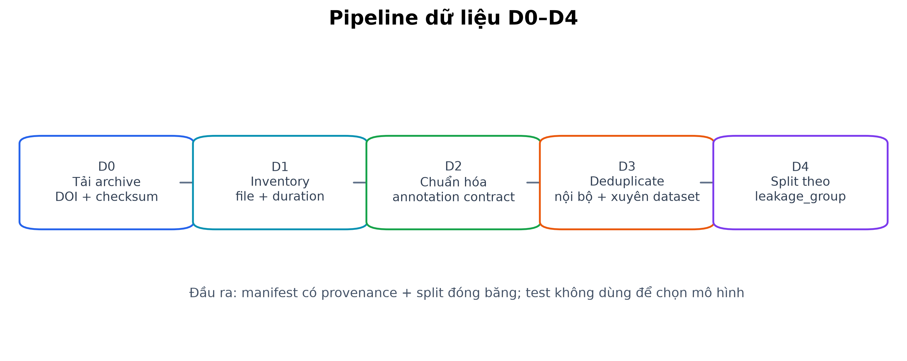

# CHƯƠNG 3. DỮ LIỆU VÀ QUY TRÌNH CHUẨN BỊ

## 3.1. DataSEC

DataSEC là tập dữ liệu phân loại sự kiện âm thanh môi trường. Nhãn của mỗi clip được mã hóa trong cây thư mục thay vì một bảng annotation riêng. Một số coarse class có thêm thư mục subclass, do đó pipeline phải lưu đồng thời nhãn nguồn, canonical coarse ID và subclass ID nếu có. Chúng tôi dùng DataSEC cho bài toán phân loại, tiền huấn luyện encoder và phân tích subclass; tập này không được dùng làm benchmark temporal vì không cung cấp onset và offset cho soundscape liên tục.

Phiên bản archive trong đề tài được kiểm kê trực tiếp thay vì ép thống kê theo bài báo. Bài mô tả dữ liệu cung cấp bối cảnh và quy trình công bố, nhưng phiên bản DataSEC mà đề tài tải mới hơn phiên bản được mô tả trong bài [@fredianelli2025environmental]. Vì vậy, số file và thời lượng trong báo cáo lấy từ manifest của archive thực tế.

## 3.2. DataSED

DataSED là tập dữ liệu SED trên các bản ghi môi trường. Nhãn nằm trong các bảng CSV và chứa tên bản ghi, lớp, onset, offset cùng các trường thời gian tương đối. Chúng tôi dùng thời gian theo giây làm nguồn chân lý vì các trường phần trăm đã được làm tròn. Phiên bản polyphonic là benchmark chính; phiên bản monophonic chỉ được dùng cho kiểm tra độ phủ và phân tích phụ.

Vai trò của hai dataset và split đã đóng băng được tổng hợp ở Bảng 3.1.

**Bảng 3.1. Dữ liệu và split đóng băng**

| Dataset | Bài toán | File | Giờ | Train | Validation | Test | Nhóm leakage | SHA split |
|---|---|---:|---:|---:|---:|---:|---:|---|
| DataSEC | Phân loại | 5048 | 23.71 | 3434 | 744 | 740 | 4873 | `e8d3099010ac…` |
| DataSED | SED đa âm | 717 | 18.68 | 438 | 137 | 142 | 687 | `d2924a5e45c2…` |

**Nguồn bảng:** trích nguyên văn từ [`tables/01_data_split.md`](tables/01_data_split.md), được sinh từ `data/manifests/datasec_inventory_summary.json`, `data/manifests/datased_inventory_summary.json` và hai split đóng băng.

Các tập được chia theo leakage group, không chia độc lập từng cửa sổ hay từng event. Cách làm này giữ các đoạn có cùng nguồn nội dung trong một evaluation boundary. DataSEC và DataSED có kích thước và cơ chế nhãn khác nhau nên không buộc dùng cùng tỷ lệ danh nghĩa; điều bất biến là mọi item chỉ thuộc một split và mọi thành viên của một leakage group phải đi cùng nhau. Tỷ lệ DataSED và lý do giữ dev/test đủ lớn được ghi tại [ADR-0008](../decisions/ADR-0008-ti-le-split-datased.md); định danh item DataSEC bằng `file_id` thay vì bịa `recording_id` được ghi tại [ADR-0010](../decisions/ADR-0010-dinh-danh-datasec-va-cong-freeze.md).

## 3.3. Taxonomy và ánh xạ nhãn

Taxonomy đóng băng gồm 22 coarse class dùng cho DataSEC, 28 subclass nằm trong 10 coarse class, và 21 class trong head SED polyphonic của DataSED. `wind_turbine` có trong taxonomy coarse và bản monophonic nhưng không thuộc tập nhãn polyphonic. Các con số này được kiểm trực tiếp từ archive và config; class order chỉ được đọc từ `ml/configs/taxonomy.yaml`, không hardcode trong model hoặc service.

**Nguồn số liệu taxonomy:** `docs/measurements/archive_audit_20260922.md`; định nghĩa ngữ nghĩa và mapping nằm tại `docs/taxonomy.md`.

Ánh xạ có dạng:

```text
source_label → canonical_class_id → optional_subclass_id
```

Chúng tôi giữ nguyên `source_label` để bảo toàn provenance, còn canonical ID được dùng xuyên suốt huấn luyện, caption, event store và giao diện. Nhãn lạ làm pipeline dừng thay vì được ánh xạ mềm. Mỗi checkpoint lưu hash taxonomy; thay đổi tập lớp hoặc thứ tự lớp phải tạo version mới. Nguồn nhãn DataSEC từ đường dẫn và tập lớp cần kiểm ở cổng D4 được khóa tại [ADR-0011](../decisions/ADR-0011-nhan-va-do-phu-lop-datasec.md).

Hai coarse class cần đặc biệt thận trọng là `sirens_and_alarms` và `thunder_fireworks_gunshot`. Khi SED chỉ cung cấp coarse evidence, caption phải giữ mức mơ hồ tương ứng, không tự chọn một subclass cụ thể. Quy tắc này bảo đảm mô tả không sắc nét hơn annotation nguồn và tuân theo nguyên tắc “mô tả nguồn âm, không mô tả tình huống” của [ADR-0001](../decisions/ADR-0001-scope-and-datasets.md).

## 3.4. Quy trình D0–D4

Quy trình dữ liệu được tổ chức thành các cổng nối tiếp. Một cổng chỉ được xem là đạt khi có artifact và kiểm tra tự động tương ứng; việc code chạy không thay thế bằng chứng dữ liệu.



### 3.4.1. Kiểm chứng archive và inventory

Ở D0, pipeline lưu metadata nguồn, giấy phép, kích thước và checksum archive rồi kiểm tra toàn vẹn trước khi giải nén. License được lấy từ Zenodo record đã lưu, không suy từ tên kho hoặc tìm trong archive. Ở D1, mỗi file được giải mã để thu sample rate, số kênh, thời lượng, SHA-256 và content hash. File lỗi, rỗng hoặc không hữu hạn phải có lý do loại trừ; số file thực tế không bị ép khớp một thống kê bên ngoài.

Thiết kế này xuất phát từ [ADR-0001](../decisions/ADR-0001-scope-and-datasets.md) và hợp đồng provenance trong `DATA_PLAN.md`: dữ liệu chỉ đi tiếp khi nguồn, license và phiên bản đều truy được. Với DataSEC, `file_id` là định danh item do archive không cung cấp recording ID độc lập; lựa chọn này tránh suy đoán quan hệ nguồn gốc không có bằng chứng ([ADR-0010](../decisions/ADR-0010-dinh-danh-datasec-va-cong-freeze.md)).

### 3.4.2. Chuẩn hóa annotation

Ở D2, pipeline kiểm tra \(0 \leq onset < offset\), đối chiếu offset với thời lượng audio, xác nhận mọi lớp ánh xạ được taxonomy và mọi annotation trỏ tới file có trong inventory. Annotation polyphonic và monophonic được xử lý thành các artifact riêng. Chúng tôi không sửa raw annotation; mọi chuẩn hóa chỉ bổ sung canonical ID và giữ nhãn nguồn bên cạnh.

Quyết định không relabel ngầm đặc biệt quan trọng với các lớp gộp. Nếu annotation nguồn chỉ có coarse class, subclass prediction không trở thành ground truth. Những trường hợp nghi ngờ được ghi vào QA hoặc phần hạn chế thay vì sửa CSV gốc.

### 3.4.3. Phát hiện trùng lặp nội bộ và xuyên dataset

Cổng D3 kiểm tra duplicate theo nhiều tầng: hash mật mã cho file giống byte, content hash cho cùng tín hiệu sau giải mã và fingerprint âm học cho đoạn cùng nguồn đã bị cắt hoặc biến đổi. Phạm vi kiểm tra bao gồm nội bộ từng dataset và xuyên DataSEC–DataSED. Luật fingerprint, hiệu chuẩn và hợp nhất nhóm được khóa tại [ADR-0007](../decisions/ADR-0007-fingerprint-va-luat-dedup.md); ngưỡng overlap và cách xử lý clip pretraining được khóa tại [ADR-0009](../decisions/ADR-0009-nguong-phu-thuoc-overlap.md).

**Bảng 3.2. Kết quả kiểm soát leakage D3/D4**

| Cổng | Chỉ báo | Kết quả | Diễn giải |
|---|---|---:|---|
| D3 | Cặp ứng viên T1/T2/T3 | 24/24/45191 | Audit 3 tầng |
| D3 | Nhóm duplicate | 84 | Nội bộ và xuyên dataset |
| D3 | Nhóm xuyên DataSEC–DataSED | 3 | Đã gom theo leakage group |
| D3 | Clip pretraining bị loại | 11 | Trùng DataSED dev/test |
| D4 | Cổng DataSEC | PASS | 5/5 kiểm tra đạt |
| D4 | Cổng DataSED | PASS | 5/5 kiểm tra đạt |

**Nguồn bảng:** trích nguyên văn từ [`tables/02_leakage_d3_d4.md`](tables/02_leakage_d3_d4.md), được sinh từ các audit và split đóng băng.

Fingerprint không thể tự quyết định chắc chắn mọi cặp gần ngưỡng. Vì vậy, chúng tôi duyệt tay 35 cặp xuyên dataset, tập trung vào việc hai file có cùng lần thu hay chỉ cùng loại nguồn âm. Trường hợp không chắc được xử lý thận trọng như một nguy cơ leakage. Bước duyệt người này là phần không tự động hóa của D3 và được hoàn tất trước khi đóng băng split.

**Nguồn số liệu duyệt tay:** `docs/measurements/review_worksheet_20260923.md`.

Khi một clip DataSEC trùng nguồn với recording DataSED thuộc validation hoặc test, clip đó bị loại khỏi corpus pretraining. Nếu các item liên quan vẫn được giữ trong cùng corpus benchmark, chúng phải nằm chung leakage group. Nhờ đó, chênh lệch transfer không được tạo ra bằng cách cho mô hình nhìn lại nguồn của tập đánh giá.

### 3.4.4. Chia tập theo leakage group

Ở D4, bộ chia làm việc trên leakage group và phân tầng theo nhãn thay vì chia ngẫu nhiên từng file. Cổng freeze xác nhận item không lặp giữa split, group không bị tách, tập lớp được phủ, chính sách exclusion được áp dụng đúng theo từng corpus và hash split khớp artifact đóng băng. Kết quả PASS của cả hai dataset được trình bày tại Bảng 3.2.

DataSEC dùng `file_id` làm khóa split, còn DataSED dùng `recording_id`; registry khai báo sự khác biệt này tập trung. Chính sách không dùng một schema giả cho cả hai dataset được chọn vì archive DataSEC không cung cấp định danh recording, và việc suy định danh từ tên lớp sẽ tạo provenance không có căn cứ ([ADR-0010](../decisions/ADR-0010-dinh-danh-datasec-va-cong-freeze.md)).

## 3.5. Thống kê và độ phủ nhãn

Bảng 3.1 cho thấy DataSEC lớn hơn DataSED về số file và được dùng làm corpus tiền huấn luyện, trong khi DataSED cung cấp các recording dài hơn cho đánh giá SED. Phân bố DataSEC mất cân bằng mạnh giữa các lớp, nên pipeline phân loại dùng sampling hoặc loss weighting và báo macro-F1 thay vì chỉ accuracy. Các lớp support thấp phải được báo bằng số tuyệt đối, không diễn giải tỷ lệ nhỏ như một ước lượng ổn định.

DataSED còn cung cấp một phép kiểm tra độc lập về độ nhất quán annotation. Có 8 cặp recording giống nhau từng byte nhưng mang recording ID và annotation riêng. Trên các cặp này, event-F1 trung bình hai chiều tại collar chuẩn là 0.5785. Chúng tôi dùng giá trị này như một **trần người chỉ báo**, không phải ước lượng agreement tổng quát, vì cỡ mẫu rất nhỏ và một số cặp bất đồng cả lớp hoặc số event.

**Nguồn số liệu trần người:** `docs/measurements/annotation_consistency_20260923.md` và `docs/measurements/sed_ceilings_20260926.md`.

Phát hiện quan trọng về độ phủ là file ground truth polyphonic gốc chỉ phủ 703/717 recording. Có 14 recording từ `S-0704` đến `S-0717` nằm trong split nhưng không có dòng polyphonic; chúng trùng với nhóm có nhãn monophonic `wind_turbine`. Pipeline lịch sử vì thế coi các recording này là âm tính: dự đoán trên đó thành false positive, trong khi event không được chú giải không thể thành false negative.

**Nguồn số liệu độ phủ và nợ #25:** `docs/measurements/polyphonic_coverage_20260927.md`.

Chúng tôi không sửa raw annotation, không thay split và không train lại để lấp phần thiếu. Theo [ADR-0034](../decisions/ADR-0034-chi-cham-recording-co-ground-truth-polyphonic.md), từ vòng chọn S13, CV và test headline chỉ chấm trên tập `annotated`; các kết quả lịch sử trên tập `all` vẫn được giữ nguyên và ghi rõ tập chấm. Các recording thiếu GT trong train vẫn là mẫu âm, do đó đây tiếp tục là một giới hạn của mô hình dù metric cuối đã loại chúng khỏi mẫu số đánh giá.

## 3.6. Rủi ro dữ liệu và biện pháp kiểm soát

Các rủi ro dữ liệu chính và biện pháp kiểm soát gồm:

- **Trùng nguồn xuyên dataset:** có thể làm sai kết luận RQ1; được kiểm soát bằng audit nhiều tầng, duyệt tay, exclusion và leakage group trước split.
- **Thiếu ground truth polyphonic:** có thể phạt dự đoán đúng như false positive; được công khai bằng measurement độ phủ và tập đánh giá `annotated` theo ADR-0034.
- **Nhiễu biên và bất đồng lớp:** làm giới hạn ý nghĩa của chênh lệch event-F1 nhỏ; được báo cùng phép đo trên các cặp byte-identical và không diễn giải trần người như một hằng số phổ quát.
- **Mất cân bằng lớp:** có thể làm mô hình ưu tiên lớp phổ biến; được xử lý trong sampling/loss và đánh giá macro theo lớp.
- **Khác biệt giữa bài báo và archive:** có thể gây sai provenance nếu chép thống kê từ văn liệu; được xử lý bằng cách dùng archive manifest làm nguồn số cho phiên bản thực nghiệm, đồng thời giữ trích dẫn bài báo cho bối cảnh dữ liệu.
- **Lớp gộp:** có thể khiến caption gọi tên cụ thể hơn nhãn; được kiểm soát bằng taxonomy versioned và hợp đồng caption không vượt mức bằng chứng.

Những biện pháp trên không làm dữ liệu trở nên hoàn hảo. Mục tiêu của chúng tôi là biến từng giới hạn thành một điều kiện có artifact, có phạm vi ảnh hưởng và có cách diễn giải nhất quán, thay vì sửa dữ liệu nguồn hoặc che giấu kết quả bất lợi.

## Cần người dùng kiểm

- [ ] Xác nhận có dùng cụm “trần người chỉ báo” cho phép đo trên 8 cặp hay đổi thành “mốc nhất quán chú giải” để tránh người đọc hiểu đây là trần tuyệt đối.
- [ ] Xác nhận mức chi tiết về nợ #25 và dải mã `S-0704`–`S-0717` nên ở thân chương hay chuyển danh sách mã sang phụ lục.
- [ ] Xác nhận cách gọi split `validation` trong bảng và từ “dev” trong phần phương pháp có cần thống nhất tuyệt đối theo mẫu khoa.
