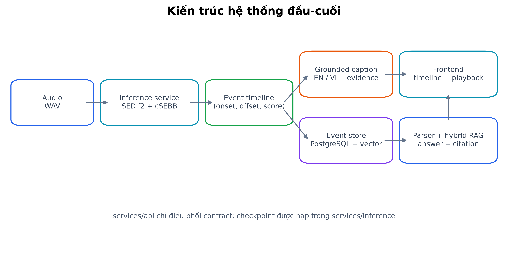
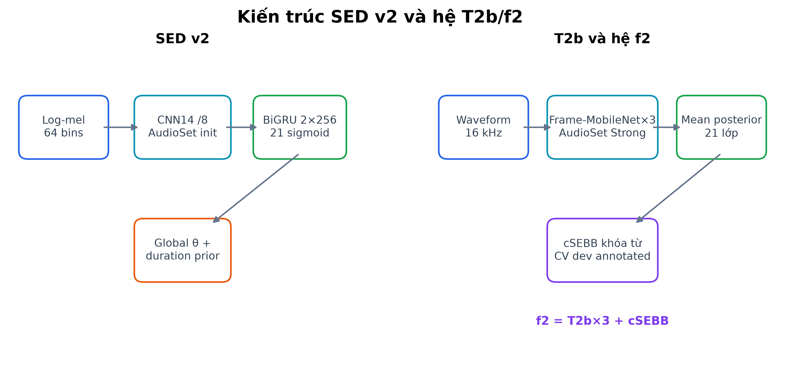

# CHƯƠNG 4. PHƯƠNG PHÁP VÀ KIẾN TRÚC HỆ THỐNG

## 4.1. Kiến trúc tổng thể

Hệ thống được tổ chức thành một pipeline có provenance xuyên suốt:

```text
audio → tiền xử lý → SED → hậu xử lý → event timeline
      → grounded caption → event store → retrieval → câu trả lời có bằng chứng
```

Mỗi tầng chỉ tiêu thụ artifact đã có contract của tầng trước. SED tạo xác suất theo thời gian; hậu xử lý chuyển xác suất thành event; timeline canonicalizer chuẩn hóa lớp, onset, offset, score, model version và taxonomy version; captioner chỉ đọc timeline; event store lưu event cùng evidence; retriever trả tài liệu và time span; answer generator chỉ tổng hợp từ phần đã truy hồi. Nhờ vậy, một câu trả lời cuối có thể được truy ngược về recording, event, phiên bản mô hình và cấu hình hậu xử lý.



Chúng tôi tách API khỏi inference. `services/api` chịu trách nhiệm upload, kiểm tra contract, persistence và orchestration; service này không import PyTorch và không tải checkpoint. `services/inference` chịu trách nhiệm tiền xử lý, SED, hậu xử lý, caption và embedding. Ranh giới này cho phép kiểm thử API không cần GPU, khởi động lại API không phải nạp lại model và giữ logic suy luận trong một thành phần chuyên biệt. Quyết định tách service được ghi tại [ADR-0029](../decisions/ADR-0029-inference-va-api-service.md), cách container hóa tại [ADR-0033](../decisions/ADR-0033-container-hoa-inference.md), và cấu hình phục vụ f2 hiện hành tại [ADR-0039](../decisions/ADR-0039-phuc-vu-he-thong-sed-cuoi-f2.md).

## 4.2. Mô hình phân loại DataSEC

Mô hình phân loại DataSEC là bước trung gian của nhánh transfer, không phải một hệ thống độc lập thay thế SED. Encoder CNN14 được khởi tạo từ checkpoint AudioSet và fine-tune trên các clip DataSEC. Việc chọn encoder này nhằm giữ cùng họ biểu diễn giữa pretraining DataSEC và SED nhánh C, để chênh lệch C−B phản ánh tác động bổ sung của DataSEC thay vì thay đổi kiến trúc. Thiết kế ba nhánh transfer và đối chứng B/C được khóa tại [ADR-0002](../decisions/ADR-0002-encoder-va-nhanh-transfer.md).

Classifier dùng một encoder chung và hai head tuyến tính: head coarse dự đoán lớp chính, head subclass dự đoán lớp con khi annotation có subclass. Hàm mất mát gồm coarse classification, subclass classification trên các mẫu hợp lệ và consistency loss. Thành phần consistency cộng xác suất subclass trong đúng coarse family và phạt khối lượng rơi ra ngoài family. Cách này cho phép head subclass học chi tiết nhưng không tạo dự đoán mâu thuẫn với parent. Kiến trúc và loss được khóa tại [ADR-0016](../decisions/ADR-0016-hierarchical-head-consistency-loss.md).

Pipeline huấn luyện dùng nhãn DataSEC từ registry và cây thư mục, nạp chuẩn hóa cùng encoder, lấy mẫu cân bằng theo coarse class và chọn checkpoint bằng metric coarse trên dev. Việc viết lại đường huấn luyện để dùng đúng feature, split và hierarchical head được ghi tại [ADR-0019](../decisions/ADR-0019-viet-lai-train-classifier-datasec.md). Calibration được báo tách khỏi accuracy để confidence có thể được kiểm tra, theo [ADR-0017](../decisions/ADR-0017-hieu-chuan-ece-datasec.md). Trên DataSED, subclass prediction chỉ là thông tin không kiểm chứng vì dataset đích không có subclass ground truth theo thời gian; hệ thống không dùng nó để thay nhãn coarse.

## 4.3. Mô hình SED

### 4.3.1. Baseline v1

Baseline v1 gồm encoder âm thanh và head tuần tự tạo logit đa nhãn theo thời gian. Trong thí nghiệm RQ1, nhánh A khởi tạo ngẫu nhiên; nhánh B nạp CNN14 từ AudioSet; nhánh C nạp encoder đã fine-tune trên DataSEC. Các nhánh dùng cùng split, ngân sách huấn luyện và giao thức hậu xử lý để chỉ khác nguồn khởi tạo. Đường nạp checkpoint, feature tương ứng và quy tắc giữ cùng thời lượng cửa sổ được khóa tại [ADR-0020](../decisions/ADR-0020-cau-hinh-panns-cho-sed-nhanh-bc.md).

Điểm yếu chính của v1 là temporal pooling thô. Việc lặp nearest-neighbor có thể đưa tensor trở lại lưới nhãn nhưng không khôi phục thông tin biên đã mất. Chúng tôi vẫn dùng v1 để trả lời RQ1 ban đầu vì nó tạo một đối chứng nhất quán, đồng thời ghi giới hạn độ phân giải như một đe dọa tính hợp lệ. Phân tích và quyết định không dùng nội suy tuyến tính để tạo cảm giác phân giải giả được ghi tại [ADR-0014](../decisions/ADR-0014-doi-chieu-do-phan-giai-thoi-gian-cnn14.md).

### 4.3.2. SED v2

SED v2 giữ khả năng nạp trọng số CNN14 nhưng giảm pooling theo thời gian, đưa sequence model hoạt động trên biểu diễn có nhịp thời gian dày hơn rồi mới đưa logit về lưới annotation. Công thức huấn luyện được mở rộng bằng random crop, lịch learning rate, mixup và FilterAugment; checkpoint được chọn bằng chỉ số frame trên dev không phụ thuộc một threshold cố định. Mục đích của thay đổi là cải thiện định vị biên và độ ổn định huấn luyện, không đổi taxonomy hoặc giao thức test.



Các thay đổi v2 được đưa vào như một recipe riêng để v1 vẫn tái lập được. Pilot, ablation và luật chọn giữa run đơn với ensemble đều dùng dev; lựa chọn được commit trước khi test. Chẩn đoán, recipe và luật lựa chọn được ghi tại [ADR-0030](../decisions/ADR-0030-cai-thien-sed-v2.md). Kết quả ablation định lượng không được diễn giải trong chương phương pháp; chúng được sinh tại [`tables/05_sed_v2_ablation.md`](tables/05_sed_v2_ablation.md) và sẽ được trình bày ở Chương 5.

### 4.3.3. T2b: Frame-MobileNet và ensemble f2

Track 2 kiểm tra encoder đã được tiền huấn luyện theo frame, dựa trên lập luận rằng giám sát theo thời gian phù hợp với SED hơn checkpoint tagging thuần clip. Văn liệu đã xác minh cho thấy encoder tiền huấn luyện theo frame có thể được dùng ở chế độ đóng băng hoặc fine-tune cho SED [@schmid2025effective]. Chúng tôi không suy từ kết quả trên dataset khác rằng model sẽ thắng trên DataSED; từng họ phải vượt cổng kỹ thuật và được chọn bằng CV dev.

T2a dùng BEATs đóng băng kết hợp head tuần tự; T2b fine-tune toàn bộ `frame_mn10` và không thêm sequence model ngoài head gốc của student. Hai hướng cung cấp đối chứng giữa biểu diễn transformer lớn đóng băng và mạng Frame-MobileNet nhỏ được thích nghi toàn bộ. Cổng khả thi, license checkpoint, pilot learning rate và các ứng viên ensemble được ghi trước tại [ADR-0032](../decisions/ADR-0032-track2-encoder-pretrain-theo-frame.md).

Hệ thống cuối f2 là ensemble ba member T2b, trung bình xác suất trước hậu xử lý và dùng cSEBB đã chọn trên dev. Cấu hình này là hạng thắng theo luật S13 đã khóa; kết quả test của các ứng viên khác không được dùng để chọn lại. Số member và hậu xử lý có thể đối chiếu tại [`tables/06_s13_ranking_test.md`](tables/06_s13_ranking_test.md). Luật đóng băng nằm tại [ADR-0031](../decisions/ADR-0031-lo-trinh-cai-thien-cuoi-va-dong-bang-model.md), còn việc phục vụ waveform Frame-MobileNet và đánh dấu `official=true` được khóa tại [ADR-0039](../decisions/ADR-0039-phuc-vu-he-thong-sed-cuoi-f2.md).

### 4.3.4. Hậu xử lý cSEBB

Họ hậu xử lý ngưỡng tạo event bằng cách nhị phân hóa posterior, làm trơn, bỏ đoạn ngắn và gộp khoảng trống. Ngưỡng \(\theta\) phụ thuộc score của model nên được chọn trên dev; duration prior được suy từ train. Tách nguồn học này ngăn việc dùng phân bố event của tập đang chấm để làm hậu xử lý, theo [ADR-0003](../decisions/ADR-0003-threshold-va-post-processing.md).

Sau khi quan sát per-class threshold dễ overfit dev, các vòng chọn cuối dùng họ \(\theta\) global làm đối chứng có ít bậc tự do hơn. Song song, cSEBB tách quyết định biên event khỏi threshold giữ/bỏ bounding box: onset và offset được xác định từ cấu trúc biến thiên của posterior, còn confidence áp cho toàn event. Phương pháp này được đề xuất như hậu xử lý SED độc lập với threshold frame [@ebbers2024sound].

Chúng tôi không giả định cSEBB luôn tốt hơn. Mỗi ứng viên được đánh giá cả họ global và cSEBB bằng cùng CV dev; họ có điểm theo luật cao hơn mới đại diện cho ứng viên ở vòng S13. Với f2, cSEBB là họ đã thắng và vì vậy service phải dùng đúng artifact này, không được chuyển lại sang threshold cũ vì thuận tiện triển khai ([ADR-0039](../decisions/ADR-0039-phuc-vu-he-thong-sed-cuoi-f2.md)).

## 4.4. Grounded captioning

### 4.4.1. Event timeline và grammar

Captioner chỉ nhận event timeline sau hậu xử lý, không nhận waveform, spectrogram hoặc metadata bối cảnh. Mỗi event cung cấp canonical class ID, onset, offset và evidence ID. Việc giới hạn đầu vào làm rõ trách nhiệm: SED quyết định nội dung âm học nào tồn tại; captioner chỉ quyết định cách diễn đạt nội dung đã có.

Hợp đồng grounding gồm:

- **G1:** mọi nguồn âm được nhắc trong caption phải thuộc tập lớp của timeline;
- **G2:** mọi mention phải liên kết tới một `event_id` trong evidence;
- **G3:** caption không được thêm nguyên nhân, ý định, bối cảnh hoặc mức nguy hiểm.

G3 đồng thời thực thi phạm vi của [ADR-0001](../decisions/ADR-0001-scope-and-datasets.md): một event âm học không phải bằng chứng cho tình trạng khẩn cấp, tội phạm hoặc risk score. Ba ràng buộc được kiểm bằng code và lexicon, không chỉ bằng đọc thủ công.

Grammar constrained phụ thuộc chính timeline đầu vào. Nó chỉ cho phép cụm lớp hợp lệ, time span của event và thứ tự không giảm theo onset; mỗi event không bị lặp tùy ý. Thiết kế này tránh hai lỗi của grammar sơ bộ là model dừng sau một item hoặc lặp một item đến hết ngân sách. Contract và grammar được khóa tại [ADR-0023](../decisions/ADR-0023-nhanh-caption-constrained.md).

### 4.4.2. Chế độ unconstrained, constrained và constrained-cover

Chúng tôi sử dụng bốn chế độ có vai trò khác nhau:

- `template` sinh tất định từ timeline, là mốc grounding theo cấu tạo và là nhánh dùng trong service;
- `unconstrained` dùng LLM với prompt timeline nhưng không dùng grammar, nhằm đo lỗi sinh tự do;
- `constrained` dùng cùng model, prompt và tham số sinh nhưng giới hạn decode bằng grammar;
- `constrained_cover` kế thừa grammar và bắt buộc nhắc event đầu tiên của mỗi lớp, nhằm giảm omission theo lớp.

Giữ cùng model và timeline giữa các nhánh giúp RQ2 cô lập tác động của ràng buộc. `unconstrained` không bị sửa output để che lỗi; `constrained` vẫn cho model quyết định dừng nên omission còn là đại lượng phải đo; `constrained_cover` bảo đảm độ phủ theo lớp nhưng tiến gần template hơn. Lựa chọn LLM, prompt và lexicon được khóa tại [ADR-0022](../decisions/ADR-0022-llm-va-lexicon-cho-rq2.md); nhánh cover và luật không thay constrained sau khi thấy test được khóa tại [ADR-0026](../decisions/ADR-0026-constrained-cover.md).

### 4.4.3. Caption tiếng Anh và tiếng Việt

Caption tiếng Anh được dùng cho benchmark RQ2. Caption tiếng Việt phục vụ giao diện và corpus song ngữ bằng template tất định, không gọi LLM dịch hoặc sinh trực tiếp. Cách này tránh thêm lỗi dịch thuật ngữ âm học và giữ G1–G3 theo cấu tạo. Lexicon tiếng Việt nằm trong file riêng để không đổi hash lexicon tiếng Anh đã đóng băng. Quyết định này được ghi tại [ADR-0025](../decisions/ADR-0025-caption-tieng-viet.md).

Với lớp gộp, cả hai ngôn ngữ giữ cách diễn đạt không chắc chắn. Hệ thống không biến `sirens_and_alarms` thành một loại phương tiện cụ thể và không chọn một thành viên duy nhất của `thunder_fireworks_gunshot`. Timeline rỗng được diễn đạt là không phát hiện event mục tiêu, không phải bản ghi im lặng.

## 4.5. Tầng RAG

### 4.5.1. Event store và tài liệu truy hồi

PostgreSQL cùng pgvector lưu recording, event, caption, evidence và retrieval document. Event là đơn vị bằng chứng trung tâm; mỗi dòng mang provenance để phân biệt ground truth với prediction. Caption evidence được lưu bằng liên kết khóa ngoại thay vì một mảng văn bản, còn retrieval document tách khỏi caption để có thể đổi embedding mà không sinh lại nội dung. Việc chọn một CSDL quan hệ có vector extension thay vì vector store thuần xuất phát từ yêu cầu self-join theo thời gian, được khóa tại [ADR-0005](../decisions/ADR-0005-database-va-vector-store.md).

Mỗi retrieval document ghép caption tiếng Anh, caption tiếng Việt và tóm tắt event canonical. Caption hỗ trợ diễn đạt tự nhiên; event summary giữ lớp, thời gian, confidence và cấu trúc mà caption có thể lược bỏ. Document được embed bằng BGE-M3 trong cùng không gian đa ngữ, còn các điều kiện cứng được lưu thành cột có index. Lựa chọn embedding và chính sách không dịch câu hỏi trước khi embed được ghi tại [ADR-0004](../decisions/ADR-0004-embedding-cho-retrieval.md); corpus và query set được khóa tại [ADR-0027](../decisions/ADR-0027-dau-vao-retrieval-va-query-set.md).

### 4.5.2. Structured, vector và hybrid retrieval

`structured_only` áp dụng filter theo lớp, thời lượng, confidence và quan hệ thời gian rồi xếp kết quả theo quy tắc tất định. `vector_only` xếp hạng theo embedding mà không có hard filter. `hybrid` lọc có cấu trúc trước và chỉ dùng vector để xếp hạng trong tập đã hợp lệ. Thứ tự của hybrid là bất biến kiến trúc: semantic score không được đưa một document vi phạm filter trở lại kết quả.

Quan hệ `before`, `after`, `overlaps` và `within` được thực hiện bằng self-join các event trong cùng recording. Vì chúng phụ thuộc onset và offset của hai event, embedding không được dùng thay thế phép kiểm thời gian. Câu trả lời chỉ tổng hợp từ record đã truy hồi và luôn trả evidence cùng `filters_applied`; nếu không đủ bằng chứng, hệ thống trả tập evidence rỗng thay vì suy diễn.

### 4.5.3. Parser câu hỏi thành bộ lọc

Parser L2 chuyển câu hỏi tiếng Anh hoặc tiếng Việt thành JSON filter theo schema sinh từ taxonomy và tập predicate hiện hành. LLM không được tạo class ngoài taxonomy, field lạ hoặc object rỗng; Pydantic hậu kiểm output trước khi query. Constrained decoding bảo đảm hình thức nhưng không bảo đảm đúng nghĩa, vì vậy chất lượng parser được đo riêng và không đồng nhất với chất lượng retrieval.

API ghi `filters_source` để phân biệt filter do người dùng cung cấp với filter do parser sinh. Khi llama.cpp không sẵn sàng, hệ thống trả lỗi parser rõ ràng và giữ bộ lọc thủ công làm fallback; nó không âm thầm bỏ filter hoặc chuyển sang vector-only. Contract, tập paraphrase và luật đánh giá parser được khóa trước lần parse đầu tại [ADR-0036](../decisions/ADR-0036-parser-cau-hoi-thanh-bo-loc-retrieval.md). Số đánh giá parser nằm tại [`tables/10_parser_l2.md`](tables/10_parser_l2.md), không được dùng để sửa schema sau test.

## 4.6. API, inference service và frontend

API cung cấp các nhóm chức năng upload, truy xuất recording, timeline, caption, audio evidence, parse câu hỏi, retrieval và model status. Mọi prediction trả kèm model version và taxonomy version. Endpoint health chỉ báo sẵn sàng khi dependency thực sự hoạt động; model status phân biệt hệ thống chính thức với cấu hình override chẩn đoán.

Inference service nhận audio, chuẩn hóa mono, chạy đúng frontend và cửa sổ của model, ensemble xác suất, áp artifact hậu xử lý đã khóa, tạo timeline, caption template song ngữ và embedding. Với f2, service dùng đường waveform Frame-MobileNet và cSEBB theo [ADR-0039](../decisions/ADR-0039-phuc-vu-he-thong-sed-cuoi-f2.md). Pipeline serving được đối chiếu với artifact nghiên cứu bằng parity; các sai khác CPU/CUDA được báo như đặc tính số học triển khai, không dùng để tuning model.

Frontend hiển thị timeline có thể phát đúng đoạn audio, caption có evidence, chip bộ lọc, câu trả lời và provenance model. Taxonomy không được khai lại trong frontend. Giao diện truy vấn tự nhiên và evidence playback được khóa tại [ADR-0037](../decisions/ADR-0037-giao-dien-truy-van-tu-nhien-va-bang-chung.md).

## 4.7. Khả năng tái lập và provenance

Mỗi run lưu config, seed, revision, trạng thái dirty, hash taxonomy, hash split, nguồn checkpoint và trạng thái complete. Prediction, post-processing và checkpoint lớn nằm ngoài Git; measurement nhỏ, manifest dữ liệu và split được commit. Artifact freeze ghi SHA-256 của các thành phần được trích trong báo cáo, còn `REPRODUCE.md` ánh xạ từng con số tới measurement và lệnh tái lập.

Giao thức lựa chọn hệ thống được ghi trước tại [ADR-0031](../decisions/ADR-0031-lo-trinh-cai-thien-cuoi-va-dong-bang-model.md). Mọi ứng viên và tie-break được đăng ký trước khi có kết quả của vòng tương ứng; lựa chọn chỉ dựa trên CV dev theo `leakage_group`; macro được báo trước trong bảng kết quả nhưng không được dùng để đổi thước chọn đã khóa. Quyết định f2 được commit trước khi mở test của các ứng viên mới. Test chỉ dùng để báo một lần và không cho phép chọn lại dù hệ khác có số test cao hơn.

Sau khi f2 được khóa, W5 và W6 được chạy lại theo runbook [ADR-0040](../decisions/ADR-0040-s8-w5-w6-tren-f2.md): validation trước, test một lần, không đổi lexicon, grammar, prompt, query set, embedding hoặc post-processing. Sổ test ghi từng lượt đã chạm test. Cách làm này không loại bỏ mọi sai lệch vận hành, nhưng khiến sai lệch có thể được phát hiện và công khai thay vì bị che bởi một lượt chạy lại có lợi hơn.

## Cần người dùng kiểm

- [ ] Xác nhận có giữ tên nội bộ `v1`, `v2`, `T2a`, `T2b` và `f2` trong thân báo cáo hay bổ sung một bảng thuật ngữ ngay đầu chương.
- [ ] Xác nhận cách dịch “hard filter” là “bộ lọc cứng” và “grounded caption” là “mô tả có căn cứ” phù hợp với thuật ngữ của giảng viên hướng dẫn.
- [ ] Xác nhận phần mô tả service nên giữ tên thư mục code (`services/api`, `services/inference`) hay chuyển chi tiết đó sang phụ lục triển khai.
